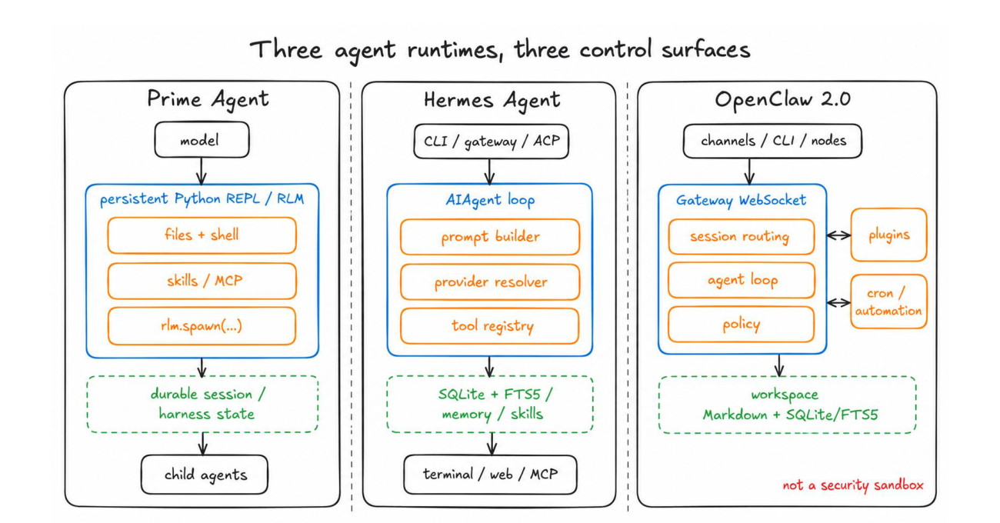
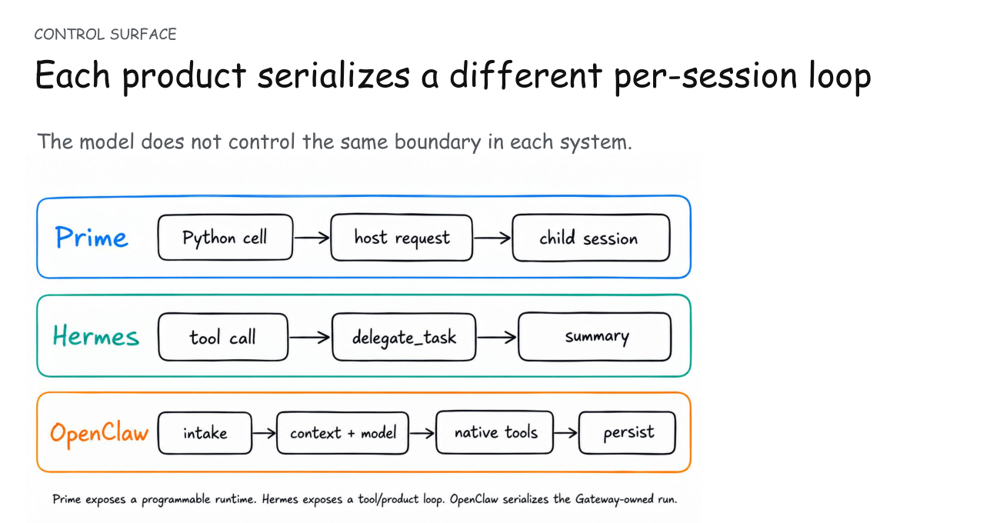
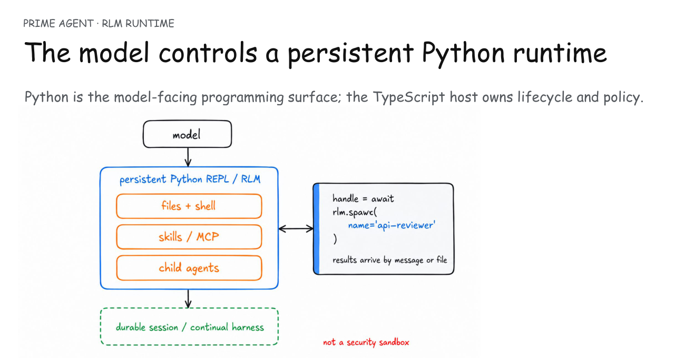
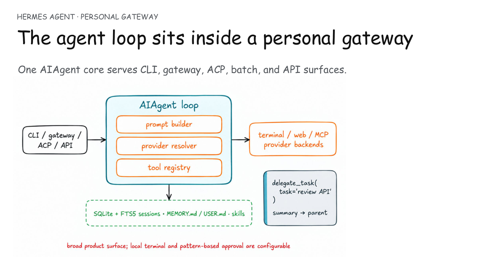
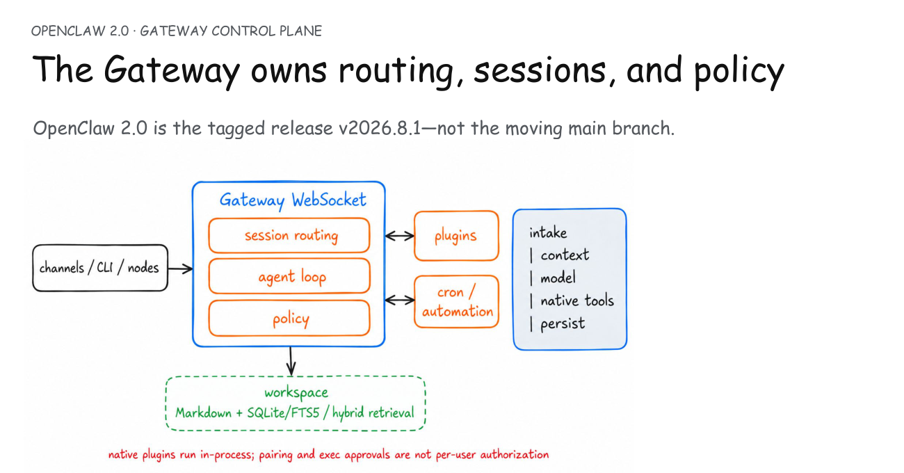
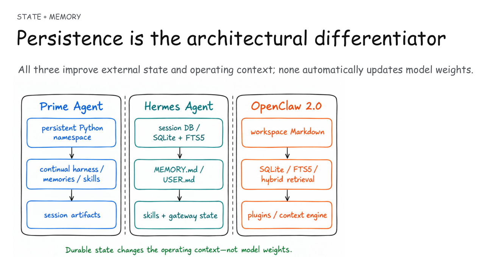
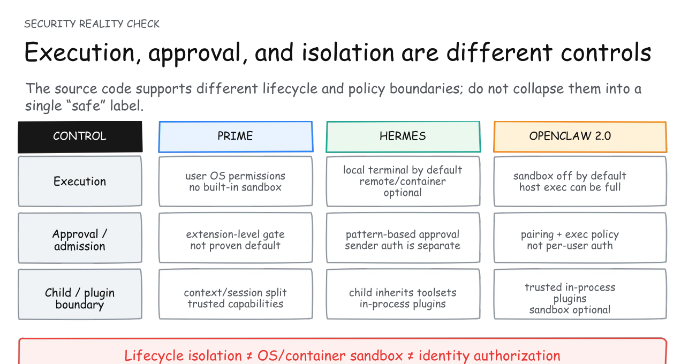
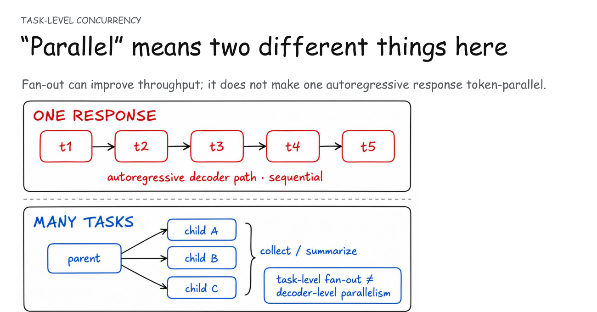

# Prime, Hermes, OpenClaw: Architecture Choices in Three Agent Runtimes

*2026-09-15 · Agent Systems / Runtime / Security*

<figure id="agent-runtime-overview" class="pb-article-hero pb-article-contain">
  
  <figcaption><strong>Figure 1.</strong> How the three runtimes take work proposed by the model, execute tools and keep the state needed later.Compiled from <a href="https://github.com/PrimeIntellect-ai/prime-agent/blob/1fc1adb6e8062bf871a9b59705c1d15468e589f0/packages/coding-agent/docs/rlm.md">Prime RLM</a>, the <a href="https://github.com/NousResearch/hermes-agent/blob/afe06f21f45f476c25034c4529818d9a2f9fdf1c/README.md">Hermes README</a> and <a href="https://github.com/openclaw/openclaw/tree/v2026.8.1/docs/gateway">OpenClaw Gateway</a>.</figcaption>
</figure>

## What is an agent harness?

Take a program repair task. The user hands an agent a repository, a failing test and a change request. The model first decides which files to read, proposes a change once the tool returns their contents, then runs the tests. When the test results come back, the model may keep fixing or may stop.

On each turn the model proposes the next piece of text or an action. Reading files, writing files and running tests are done by external programs, and their results have to be organized into context the next turn can use. If the task is interrupted, the system also has to know which tools have finished, which files have already changed, and where to pick up next time.

The program that connects model calls, tool execution, result handoff, session persistence, error recovery and permission checks is called an agent harness. It owns the execution environment for the whole piece of work.

Here, runtime means the execution organization of a harness. For a long task, you trace where a request comes in, which component owns the loop, where state is written, in which process a tool runs, and how policy steps in before an action reaches the tool.

## Where the three projects start from

Prime Agent is developed by Prime Intellect. Its README puts coding, research and general long-running work under one positioning, and organizes work around two abstractions: RLM treats context as variables that Python can operate on, and Continual Harness keeps the prompt, memory, skill descriptions and reusable subagent specifications as durable state.[^prime-readme]

Hermes Agent is developed by Nous Research. It starts from how a personal agent is used, connects the CLI and a messaging gateway to the same agent, and puts the provider, session search, memory, skills, cron and terminal backends into one self-deployable service.[^hermes-readme]

OpenClaw comes from the OpenClaw project and its community. The <code>v2026.8.1</code> README places the assistant next to the devices and chat channels the user already has, with the Gateway connecting models, tools, messaging channels and companion apps. The docs also separate the Gateway, the built-in agent runtime and the plugin harness into different layers.[^openclaw-readme] [^openclaw-runtime]

So the three projects deal with different units of work. Prime keeps one coding/research session running, Hermes keeps up an agent service that one person uses repeatedly every day, and OpenClaw keeps up a Gateway system that may span channels, devices, plugins and automation.

The versions are pinned to Prime Agent commit <code>1fc1adb6</code>, Hermes Agent commit <code>afe06f2</code> and the OpenClaw <code>v2026.8.1</code> release. This comparison calls that pinned release OpenClaw 2.0, and current main is outside its scope.[^openclaw-release]

## The execution steps of one agent task

Breaking down the program repair task above gives a path that keeps returning to the model:

~~~text
request
  -> model call
  -> action
  -> tool execution
  -> result
  -> next context
  -> model call
~~~

Every tool execution adds a handoff point. A tool may return just a few lines of test output, or it may modify files, start a long-running process or hand work to another agent. The context the next turn needs may live in memory, the session transcript, workspace files or a database.

If a test runs for ten seconds, the task's context and tool state still have to be kept while the model waits. If a tool fails halfway, the system has to tell whether the failure happened in the model call, the tool itself, the result write, or the assembly of the next turn's context. The runtime boundary forms at these handoff points.

The comparison below always follows four questions:

| What to trace | Concrete question |
| --- | --- |
| loop | Which component decides the next model call and tool call? |
| state | Which context, work products and child results can survive a turn? |
| execution | In which process, container or remote worker does the action finally run? |
| admission | Which policy or approval can let an action through, and which only records identity? |

## After the model produces an action, which layer takes over?

The control surface is the programming interface the model uses to organize its next step of work. The UI the user sees is not part of this definition. The three runtimes put this interface in different places:

| Aspect | Prime Agent | Hermes Agent | OpenClaw 2.0 |
| --- | --- | --- | --- |
| model-facing surface | persistent Python REPL / RLM | AIAgent conversation loop | OpenClaw embedded runtime |
| main owner of the loop | Python kernel plus TypeScript host | AIAgent and gateway service | Gateway plus embedded agent runner |
| how work extends | Python state, skills, <code>rlm.spawn(...)</code> | tools, skills, delegation, background task | native tools, plugins, nodes, automation |
| main benefit | long tasks can keep their workflow as code | provider, entry points and daily service in one place | routing, session, tool and policy share an owner |
| main cost | Python state, child lifecycle and host permission | service scope, memory correctness and backend scope | Gateway, plugin, node and channel scope |

<figure class="pb-article-hero pb-article-contain">
  
  <figcaption><strong>Figure 5.</strong> The three per-session loops keep different units: Prime keeps Python cells and child sessions, Hermes keeps tool calls and delegation, and OpenClaw keeps intake, context, native tools and persistence.Sources: <a href="https://github.com/PrimeIntellect-ai/prime-agent/blob/1fc1adb6e8062bf871a9b59705c1d15468e589f0/packages/coding-agent/docs/rlm.md">Prime RLM</a>, the <a href="https://github.com/NousResearch/hermes-agent/blob/afe06f21f45f476c25034c4529818d9a2f9fdf1c/README.md">Hermes README</a>, <a href="https://github.com/openclaw/openclaw/tree/v2026.8.1/docs/gateway">OpenClaw Gateway</a>.</figcaption>
</figure>

Prime's RLM doc puts a persistent Python kernel between the model and the tools. The built-in model tool is <code>ipython</code>, and reading files, editing, running commands, transforming results, calling skills and creating subagents all fan out from this kernel. Python variables, imports, functions and task handles survive across later tool calls, so the context does not have to be rebuilt as one giant message each time.[^prime-rlm]

<figure class="pb-article-hero pb-article-contain">
  
  <figcaption><strong>Figure 2.</strong> Prime puts persistent Python / RLM at the model-facing surface. Files, shell, skills, MCP and child agents all branch out from this working surface.Source: <a href="https://github.com/PrimeIntellect-ai/prime-agent/blob/1fc1adb6e8062bf871a9b59705c1d15468e589f0/packages/coding-agent/docs/rlm.md">Prime RLM</a>.</figcaption>
</figure>

<code>rlm.spawn(...)</code> also creates child sessions along this interface. The call finishes task admission first and returns a child handle. The child's result has to come back to the parent through <code>agent_message</code> or a file. This lets the parent schedule several independent jobs on the same Python working surface, but a child's lifecycle and result merging cannot be treated like an ordinary synchronous function.[^prime-rlm]

Prime's TypeScript host still owns provider calls, session persistence, child lifecycle, scheduling and safety policy. Persistent Python is a control environment the model can program, while the provider, session and safety policy are still managed by the host. The RLM doc states plainly that the Python kernel runs model-generated Python and project commands with the worker's operating-system permissions. The worker and kernel improve lifecycle isolation and recovery, and permission isolation needs an external sandbox or a restricted environment.

This split suits work that repeatedly reads data, transforms results and dispatches subtasks. The cost is that on recovery you have to confirm that the Python state, file side effects, child registry and host process are consistent. The more freedom the program has, the more state a resume has to rebuild.

Hermes keeps its control flow in the AIAgent conversation loop. The CLI and the messaging gateway are two entry points, and the gateway can send work from Telegram, Discord, Slack, WhatsApp, Signal and the CLI into the same service. The AIAgent layer assembles the prompt, resolves the provider, builds the tool surface, then handles each tool result and the next model call in order.[^hermes-readme] [^hermes-loop]

<figure class="pb-article-hero pb-article-contain">
  
  <figcaption><strong>Figure 3.</strong> Hermes connects the CLI and the messaging gateway to the AIAgent loop. The provider, tool registry, terminal backend, memory, skills and cron are kept up by one personal service.Source: <a href="https://github.com/NousResearch/hermes-agent/blob/afe06f21f45f476c25034c4529818d9a2f9fdf1c/README.md">Hermes README</a>.</figcaption>
</figure>

Hermes extends through tools, skills, delegation or background tasks. The terminal backend can be local, Docker, SSH, Singularity, Modal, Daytona or Vercel Sandbox, and the backend decides where the actual commands run. What the model gets is the tool surface the service provides, while workflow state is held by the session, memory, skills and background machinery.[^hermes-readme]

This arrangement suits using the same assistant from different entry points every day. Provider switching, session search, memory loading and scheduled automation do not need to be spread across several separate runtimes. The maintenance questions that follow concentrate in the service: whether the session was written, whether the FTS5 index was updated, whether memory retrieved stale content, and whether the terminal backend lines up with the expected workspace.

OpenClaw puts the Gateway between the entry points and the agent runtime. The Gateway is the control plane for sessions, tools, events and channel connections. The built-in agent runtime lives in <code>src/agents/</code> and <code>@openclaw/agent-core</code>, and owns the attempt loop, model/provider wiring, compaction, transcript and session wiring. Plugins can register other harnesses, but that extends runtime selection and does not change the Gateway's position as the owner of entry and coordination.[^openclaw-readme] [^openclaw-runtime] [^openclaw-runtimes]

<figure class="pb-article-hero pb-article-contain">
  
  <figcaption><strong>Figure 4.</strong> OpenClaw connects channels, the CLI, nodes, plugins and automation to the Gateway, and the embedded runtime then handles the agent turn.Sources: <a href="https://github.com/openclaw/openclaw/tree/v2026.8.1/docs/gateway">Gateway docs</a> and <a href="https://github.com/openclaw/openclaw/blob/v2026.8.1/docs/agent-runtime-architecture.md">agent runtime architecture</a>.</figcaption>
</figure>

The Gateway's centralized ownership lets OpenClaw handle session routing, channel delivery, node capability and tool policy in one place. This helps in a multi-entry system, because whether one session can be seen by another channel, node or automation does not have to be decided by each plugin separately.

Centralization also has another consequence: the Gateway becomes a high-value shared trust boundary. Whether a plugin runs in the same process, which commands a node can expose, and whether session context flows across channels all have to be checked together with the Gateway's policy. A name like Gateway, plugin or node cannot by itself prove that process isolation exists.

## How does work state survive?

Agent state comes in at least three kinds. The first is the context the next model call needs. The second is the work products a tool produces, such as files, test results and child output. The third is memory, skills or schedules that can outlive the current task. The three do not necessarily share a lifecycle.

<figure class="pb-article-hero pb-article-contain">
  
  <figcaption><strong>Figure 6.</strong> The state each runtime keeps: Prime centers on the Python namespace, session artifacts and Continual Harness. Hermes centers on the session database, Markdown memory and skills. OpenClaw centers on the transcript, workspace, memory index and Gateway-owned state.Sources: <a href="https://arxiv.org/abs/2605.09998">Continual Harness</a>, the <a href="https://github.com/NousResearch/hermes-agent/blob/afe06f21f45f476c25034c4529818d9a2f9fdf1c/README.md">Hermes README</a>, <a href="https://github.com/openclaw/openclaw/blob/v2026.8.1/docs/concepts/memory-architecture.md">OpenClaw memory architecture</a>.</figcaption>
</figure>

| State type | Prime Agent | Hermes Agent | OpenClaw 2.0 |
| --- | --- | --- | --- |
| turn / session | Python kernel, session artifact, daemon-backed session | AIAgent session, gateway transcript, SQLite session store | Gateway session, transcript, embedded runner state |
| working context | Python variables, parsed results, task handles | conversation context, loaded skills, tool results | assembled context, compaction state, workspace files |
| long-term data | Continual Harness prompt, memory, skills and subagent specifications | <code>MEMORY.md</code>, <code>USER.md</code>, skills, FTS5 session search | <code>MEMORY.md</code>, <code>USER.md</code>, daily notes, SQLite memory index |
| background work | retained child, heartbeat, schedule, persistent goal | delegation, background task, cron | automation, standing intent, node / plugin run |
| what to confirm on resume | kernel state, child registry, file side effects | session write, index, memory scope, terminal backend | session routing, transcript, memory provenance, plugin state |

Prime's state sits right next to the workflow. The Python namespace can keep parsed results and task handles, and Continual Harness then keeps supplemental state that can outlive one chat window. This means a long task does not have to stuff all intermediate data back into the prompt. On resume, you have to check that both the live kernel state and the files already written still hold.[^prime-rlm] [^continual-harness]

Hermes's state mainly serves a long-lived personal service. Session search lets old conversations be found again, <code>MEMORY.md</code> and <code>USER.md</code> provide fairly stable personal context, and skills keep repeated operations as loadable capabilities. This design is convenient across entry points, but data writes, indexing and retrieval become reliability problems on the same request path.

OpenClaw's state is made up of the session transcript, workspace memory and data managed by the Gateway. Its memory architecture keeps readable Markdown files separate from the SQLite index, and handles provenance, scope and admission at recall time. This lets memory be inspected and deleted, and it also means the origin of channel, agent, workspace and session must be saved together.[^openclaw-memory]

All three kinds of state can be abstracted as:

~~~text
write
  -> organize or index
  -> retrieve
  -> inject into the next model call
~~~

The differences are who owns the write and when retrieval happens. Prime's live Python state can be used directly by the next cell. Hermes needs the service to assemble session, memory and skills back into the AIAgent. OpenClaw has to put channel, session, workspace and memory policy together into the Gateway's context assembly.

## Where does tool execution permission end?

An action passes three different checkpoints:

1. The model proposes the action.
2. Policy, approval or pairing decides whether the action can enter the execution path.
3. Some process, container or remote worker actually executes the action.

These three steps may be handled by different components. An approval records "this action is allowed", and process isolation has to be verified separately. Pairing confirms "this device or sender is recognized", and command scope still has to be checked separately.

<figure class="pb-article-hero pb-article-contain">
  
  <figcaption><strong>Figure 7.</strong> Execution, approval / admission and the child / plugin boundary are checked separately. Lifecycle isolation, an OS / container sandbox and identity authorization each answer a different question.Sources: <a href="https://github.com/PrimeIntellect-ai/prime-agent/blob/1fc1adb6e8062bf871a9b59705c1d15468e589f0/README.md">Prime Agent README</a>, the <a href="https://github.com/NousResearch/hermes-agent/blob/afe06f21f45f476c25034c4529818d9a2f9fdf1c/README.md">Hermes README</a>, <a href="https://github.com/openclaw/openclaw/tree/v2026.8.1/docs/gateway">OpenClaw Gateway docs</a>.</figcaption>
</figure>

Prime's Python kernel runs model-generated Python and project commands with the worker's operating-system permissions. Prime's worker, kernel and daemon let a session persist and recover, but the RLM doc explicitly calls them a durable control environment and not a security sandbox. When reviewing a Prime deployment, trace files, network and credentials along the kernel, shell bridge, host process and user environment.

Hermes puts the terminal backend at the end of the tool path. The README lists local, Docker, SSH, Singularity, Modal, Daytona and Vercel Sandbox, and the security doc lists command approval, DM pairing and container isolation separately. Hermes's execution scope depends on the backend currently selected, the mounted secrets, the working directory and the approval mode. AIAgent's approval request covers only one segment of that.[^hermes-security]

OpenClaw splits session permission mode, tool policy, exec approval, sandbox and node pairing into several control planes. The Gateway docs say that tools in the main session can run on the host by default, and the sandbox has to be configured separately. Node pairing only controls the device handshake and the declared capability surface, and node commands still have to pass the normal command policy. When reviewing OpenClaw, confirm Gateway auth, channel identity, node capability, plugin process and sandbox workspace separately.[^openclaw-security] [^openclaw-pairing]

| Check layer | Prime Agent | Hermes Agent | OpenClaw 2.0 |
| --- | --- | --- | --- |
| execution | Python kernel, shell bridge, host process | the selected terminal backend | Gateway host, sandbox or node backend |
| admission | host safety policy, extension / skill path | command approval, tool policy, sender pairing | permission mode, exec policy, channel / node pairing |
| isolation | worker / kernel lifecycle boundary; a sandbox has to be configured separately | the actual isolation of the local, container or remote backend | layered configuration of sandbox, host execution, plugins and nodes |
| review focus | OS permissions, skills, credentials, child results | backend, approval, mounted secrets, working directory | Gateway auth, channel scope, node commands, plugins and sandbox |

## Which work can run in parallel?

Parallelism happens at the task level and does not remove the token dependency inside a single answer. Take a research task: reading three independent batches of documents can go to three children or workers, but each child's own model call still generates tokens along the autoregressive path.

<figure class="pb-article-hero pb-article-contain">
  
  <figcaption><strong>Figure 8.</strong> A parent can dispatch independent work to child A, B and C, then collect the results. The token path of each response is still generated in order.Sources: Prime's <a href="https://github.com/PrimeIntellect-ai/prime-agent/blob/1fc1adb6e8062bf871a9b59705c1d15468e589f0/packages/coding-agent/docs/rlm.md">RLM</a>, Hermes's <a href="https://github.com/NousResearch/hermes-agent/blob/afe06f21f45f476c25034c4529818d9a2f9fdf1c/README.md">delegation</a>, OpenClaw's <a href="https://github.com/openclaw/openclaw/tree/v2026.8.1/docs/gateway">automation path</a>.</figcaption>
</figure>

Prime uses <code>rlm.spawn(...)</code> to create child sessions in the Python workspace. Hermes uses delegation and background tasks. OpenClaw can start other work from automation, plugins or nodes. These interfaces handle dispatching several jobs, while the tokens of a single answer are still generated along the autoregressive path.

With <code>n</code> independent subtasks, the serial execution time can be written as:

$$
T_{\text{serial}} = \sum_{i=1}^{n} T_i
$$

Only when resources are sufficient, the subtasks are truly independent and the cost of merging results is acceptable can the parallel execution time approach:

$$
T_{\text{parallel}} \approx \max_i(T_i) + T_{\text{dispatch}} + T_{\text{merge}}
$$

Prime's dispatch cost shows up in child admission, context splitting and result messages. Hermes has to maintain background scope, session ownership and the terminal environment. OpenClaw also has to fit plugins, nodes, channels and Gateway policy into the same lifecycle. Parallelism shortens the critical path and also adds state and trust surface to track.

## Design tradeoffs and where each fits

| Runtime | workload shape | control surface | state owner | execution boundary | fitting deployment | cost to take on |
| --- | --- | --- | --- | --- | --- | --- |
| Prime Agent | long-running coding, research, repeated data processing | persistent Python / RLM | Python namespace, session artifact, Continual Harness | worker, kernel, shell bridge and host | need to write the workflow as code and keep intermediate results | Python state recovery, child lifecycle, host permission |
| Hermes Agent | long-term personal use, daily work across the CLI and messaging | AIAgent service | session DB, FTS5, Markdown memory, skills | local, container or remote terminal backend | need provider, memory, skills, cron and multiple entry points managed in one place | service scope, memory retrieval, terminal backend |
| OpenClaw 2.0 | many channels, devices, plugins, automation | Gateway plus embedded runtime | transcript, workspace, memory index, Gateway state | host, sandbox, plugins and nodes | need one control plane to unify routing, session and policy | Gateway trust boundary, channel scope, plugin / node policy |

Choosing Prime mainly gets you a programming surface the model can keep operating. It suits coding or research with many intermediate results and many subtasks, where the workflow needs to be preserved. The deployer has to put Python, shell, skills and host permissions into an environment that is recoverable and reviewable.

Choosing Hermes mainly gets you an integration surface centered on a personal service. It suits coming back to the same assistant from different entry points every day. The deployer has to maintain the provider, session database, memory files, cron and terminal backend as the state of one service.

Choosing OpenClaw mainly gets you the Gateway's shared ownership of entry points, sessions, tools, nodes and policy. It suits a self-hosted system with many channels and external components. The deployer has to put Gateway auth, channel scope, plugin trust, node capability and sandbox settings into the same review.

A deployment review can follow four lines:

| Review question | Evidence to keep |
| --- | --- |
| Who takes over the next action? | loop owner, tool registry, runtime selection |
| Where does recovery start after an interruption? | session artifact, workspace, memory index, child / background state |
| Where does the action finally execute? | process, container, remote worker, working directory |
| Who can let it through? | policy, approval, pairing, credential scope |

These four lines map to the failures most likely in the three runtimes: intermediate state lost on recovery, memory retrieving the wrong context, and the model getting more permission than expected.

[^prime-readme]: [Prime Agent README at commit 1fc1adb6](https://github.com/PrimeIntellect-ai/prime-agent/blob/1fc1adb6e8062bf871a9b59705c1d15468e589f0/README.md). Used for Prime's positioning on coding, research, long-running work, RLM and Continual Harness.
[^prime-rlm]: [Prime Agent RLM programming model at commit 1fc1adb6](https://github.com/PrimeIntellect-ai/prime-agent/blob/1fc1adb6e8062bf871a9b59705c1d15468e589f0/packages/coding-agent/docs/rlm.md). Used for persistent Python, child admission, child lifecycle, host bridge and trust model.
[^continual-harness]: [Continual Harness](https://arxiv.org/abs/2605.09998). Used for the runtime framing of durable prompt, memory, skill and subagent state.
[^hermes-readme]: [Hermes Agent README at commit afe06f2](https://github.com/NousResearch/hermes-agent/blob/afe06f21f45f476c25034c4529818d9a2f9fdf1c/README.md). Used for Hermes's personal-agent scope, gateway, provider, memory, skills, cron, delegation and terminal backend.
[^hermes-loop]: [Hermes conversation loop at commit afe06f2](https://github.com/NousResearch/hermes-agent/blob/afe06f21f45f476c25034c4529818d9a2f9fdf1c/agent/conversation_loop.py). Used for AIAgent's multi-turn tool-call loop and tool result handoff.
[^hermes-security]: [Hermes security guide at commit afe06f2](https://github.com/NousResearch/hermes-agent/blob/afe06f21f45f476c25034c4529818d9a2f9fdf1c/website/docs/user-guide/security.md). Used for command approval, pairing, container isolation and terminal security scope.
[^openclaw-readme]: [OpenClaw README at v2026.8.1](https://github.com/openclaw/openclaw/blob/v2026.8.1/README.md). Used for the project scope of devices, chat channels, Gateway, models, tools, nodes and plugins.
[^openclaw-release]: [OpenClaw v2026.8.1](https://github.com/openclaw/openclaw/tree/v2026.8.1). This comparison calls this pinned release OpenClaw 2.0.
[^openclaw-runtime]: [OpenClaw agent runtime architecture at v2026.8.1](https://github.com/openclaw/openclaw/blob/v2026.8.1/docs/agent-runtime-architecture.md). Used for the embedded runner, agent core, session wiring, tool definitions, harness registry and runtime selection.
[^openclaw-runtimes]: [OpenClaw agent runtimes at v2026.8.1](https://github.com/openclaw/openclaw/blob/v2026.8.1/docs/concepts/agent-runtimes.md). Used for the layering of provider, model, agent runtime, harness and Gateway ownership.
[^openclaw-memory]: [OpenClaw memory architecture at v2026.8.1](https://github.com/openclaw/openclaw/blob/v2026.8.1/docs/concepts/memory-architecture.md). Used for Markdown memory, SQLite index, provenance, recall and memory admission.
[^openclaw-security]: [OpenClaw gateway security documentation at v2026.8.1](https://github.com/openclaw/openclaw/tree/v2026.8.1/docs/gateway). Used for session permission, tool policy, sandbox, exec approval and the Gateway security boundary.
[^openclaw-pairing]: [OpenClaw node pairing at v2026.8.1](https://github.com/openclaw/openclaw/blob/v2026.8.1/docs/gateway/pairing.md). Used for the boundary between device pairing, node capability approval and command policy.
