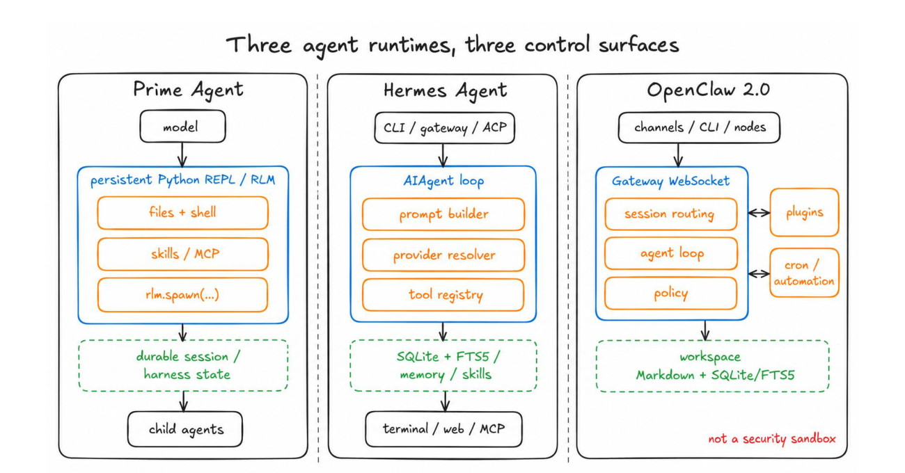
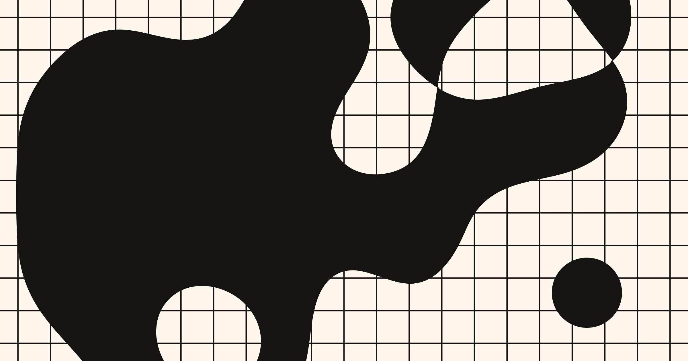
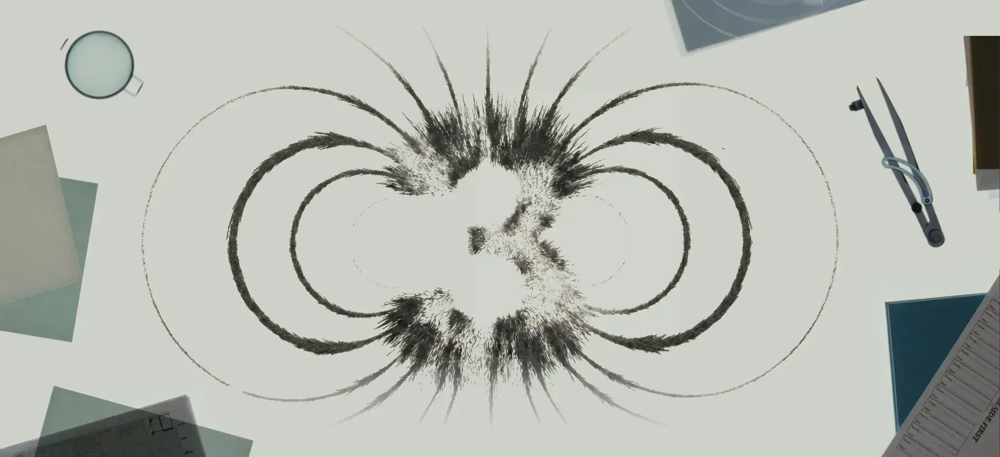
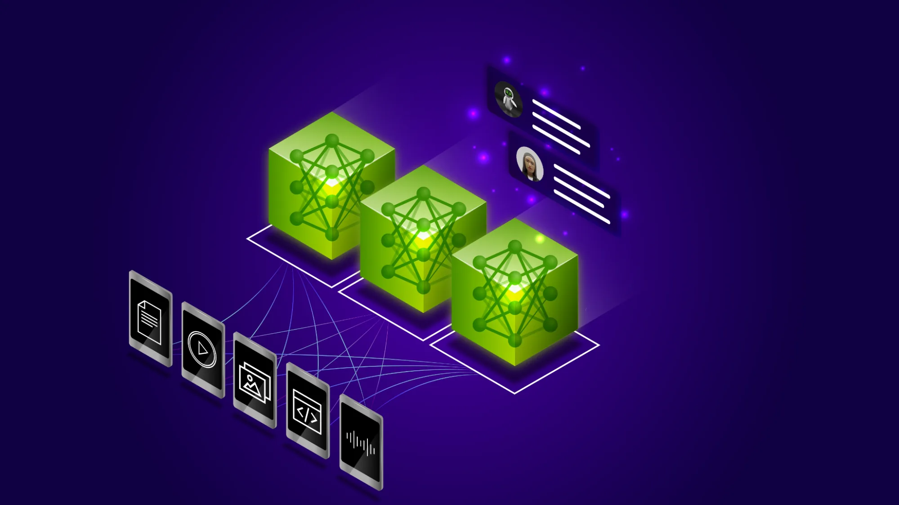
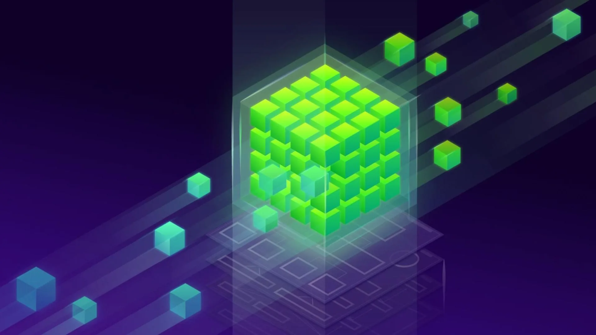
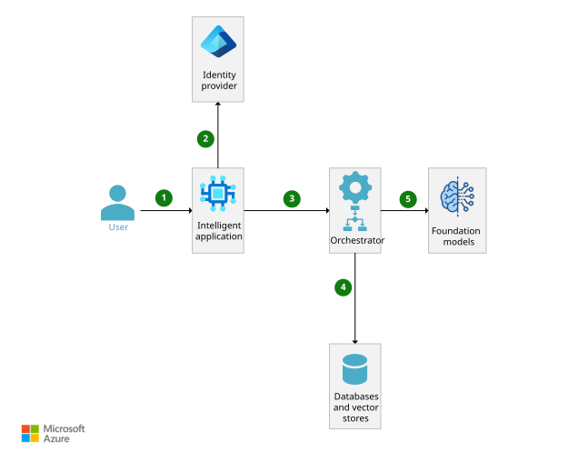
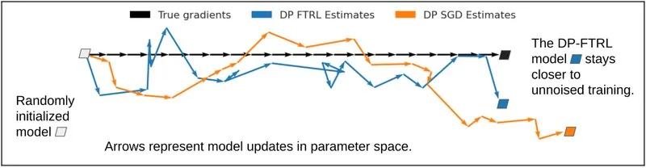
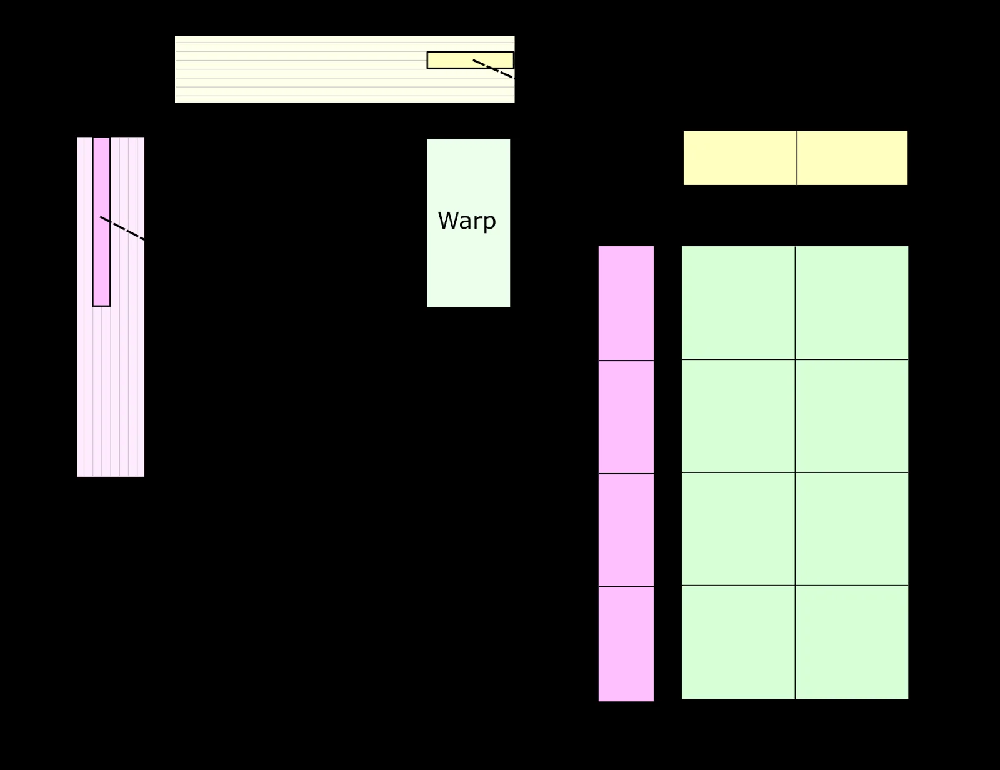
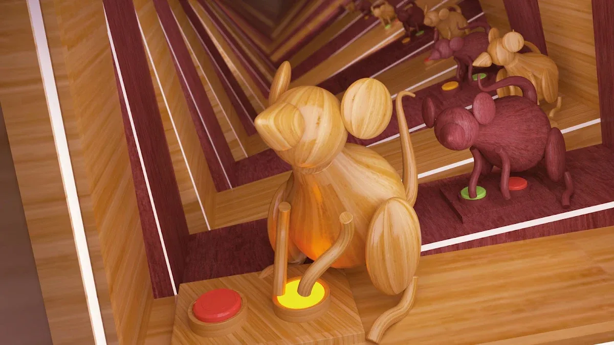
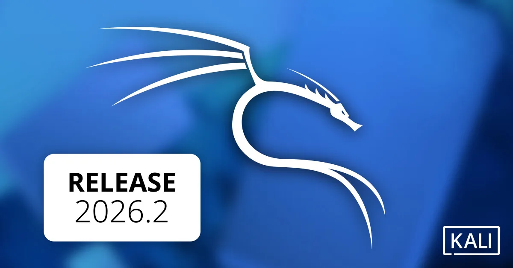

# Blog

Notes I write while reading model releases and running benchmarks: architecture,
serving, CUDA, and some privacy and security. When a post makes a claim, the
measurement or source that backs it sits right beside it.

Topics:
<button type="button" data-tag="Architecture">Architecture</button>
<button type="button" data-tag="Serving">Serving</button>
<button type="button" data-tag="CUDA">CUDA</button>
<button type="button" data-tag="Distributed">Distributed</button>
<button type="button" data-tag="RAG">RAG</button>
<button type="button" data-tag="Privacy">Privacy</button>
<button type="button" data-tag="ML">ML</button>
<button type="button" data-tag="Security">Security</button>

<a class="pb-post-card" href="vllm-flashinfer-async-race/" data-tags="Serving,CUDA">
Wayne

Which patch cleared the FlashInfer fault on my card
ServingCUDA
Five vLLM builds, 30 servers each, on one Blackwell workstation GPU: main faulted 8 times without #64165 and never with it.
2026-11-16

</a>
<a class="pb-post-card" href="agent-harness-boundaries/" data-tags="Architecture,Agents,Security">
Wayne

Prime, Hermes, OpenClaw: Architecture Choices in Three Agent Runtimes
ArchitectureAgentsSecurity
From persistent Python to a personal agent service to a Gateway control plane: how three runtimes take over the model's work.
2026-09-15

</a>
<a class="pb-post-card" href="inkling-975b-architecture/" data-tags="Architecture">
Thinking Machines

Inkling 975B: How 5:1 Hybrid Attention Reallocates Compute
ArchitectureMoEMultimodal
5:1 sliding windows, relative position encoding, short convolutions and Muon/Adam in Thinking Machines' first open-weight model, checked against the official material.
2026-07-20

</a>
<a class="pb-post-card" href="kimi-k3-architecture/" data-tags="Architecture">
Moonshot AI

Kimi K3 2.8T: KDA, AttnRes and a 16-of-896 MoE
ArchitectureLinear AttentionAgents
KDA, Attention Residuals and a 16-of-896 Stable LatentMoE, and the difference between the API being live and the weights still unreleased.
2026-07-20

</a>
<a class="pb-post-card" href="notes-trtllm-triton-serving/" data-tags="Serving">
NVIDIA

TensorRT-LLM vs vLLM on 4×H100: The Concurrency Crossover
ServingNVIDIA stack
A matched benchmark: TensorRT-LLM leads at low and mid concurrency, vLLM leads at high concurrency.
2026-05-31

</a>
<a class="pb-post-card" href="nccl-nvlink-bandwidth/" data-tags="Distributed">
NVIDIA

Where tensor-parallel inference hits the NVLink wall
GPUDistributed
366 GB/s against a 23 μs fixed cost, and what NVLS, CUDA Graphs and symmetric memory each change when measured separately.
2026-05-31

</a>
<a class="pb-post-card" href="rag-groundedness-guardrail/" data-tags="RAG,Security">
Microsoft Learn

The 0% RAG result failed the harder test
LLMRAG
0% on the easy set, 48% on adversarial near-misses. Across nine gates, a grounded verifier caught errors the generative judges missed.
2026-05-31

</a>
<a class="pb-post-card" href="notes-federated-learning-dp/" data-tags="Privacy,ML,Security">
Google Research

FedAvg Under Non-IID Data: What DP-SGD and Secure Aggregation Protect
PrivacyFL
From client drift to privacy bounds: measured limits of FedAvg, FedProx, SCAFFOLD, DP-SGD and secure aggregation.
2026-05-31

</a>
<a class="pb-post-card" href="notes-cuda-tensor-core-gemm/" data-tags="CUDA">
NVIDIA

From Naive GEMM to WMMA: Where Each CUDA Kernel Stalls
CUDAKernels
Naive, shared-memory tiling and WMMA kernels compared, with cuBLAS on the same shape as the production baseline.
2026-05-31

</a>
<a class="pb-post-card" href="meta-rl/" data-tags="ML">
Google DeepMind

Meta-RL: Teaching a Policy to Update Itself Within an Episode
MLRL
Task inference placed in gradients, recurrent state or latent context, and how to test for adaptation rather than task memorization.
2025-01-11

</a>
<a class="pb-post-card" href="pp-intro/" data-tags="CUDA">
NVIDIA

Intro to CUDA Programming
CUDAParallel
Using the execution model, memory hierarchy and synchronization to find where a CUDA kernel is actually bound.
2025-01-11

</a>
<a class="pb-post-card" href="pentest-intro/" data-tags="Security">
Kali Linux

A Pentest Is Not a Scanner: From Authorization Boundaries to Retestable Evidence
Security
Rules of Engagement before tools, then minimal verification, an evidence chain and acceptance tests to hand each finding to the people fixing it.
2025-01-10

</a>

Image sources

Artwork and diagrams are credited to their original publishers: [Thinking Machines](https://thinkingmachines.ai/news/introducing-inkling/), [Moonshot AI](https://platform.kimi.ai/), [NVIDIA Developer](https://developer.nvidia.com/blog/), [Microsoft Learn](https://learn.microsoft.com/en-us/azure/architecture/ai-ml/guide/secure-multitenant-rag), [Google Research](https://research.google/blog/federated-learning-with-formal-differential-privacy-guarantees/), [Google DeepMind](https://deepmind.google/blog/prefrontal-cortex-as-a-meta-reinforcement-learning-system/), and [Kali Linux](https://www.kali.org/blog/kali-linux-2026-2-release/).

