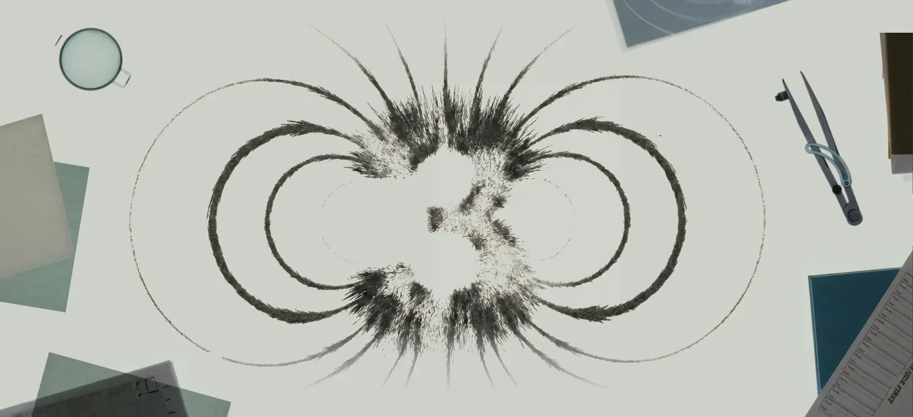

# Kimi K3 2.8T: KDA, AttnRes and a 16-of-896 MoE

*2026-07-20 · LLM Architecture / Linear Attention / Agentic Coding*

<figure class="pb-article-hero">
  
  <figcaption>Official platform key visual · <a href="https://www.kimi.com/blog/kimi-k3">Source: Moonshot AI</a></figcaption>
</figure>

Moonshot AI has released the **Kimi K3** API: 2.8T total parameters, native vision and 1M-token context, aimed at long-horizon coding, knowledge work and reasoning. It hands the problem of very long sequences to **Kimi Delta Attention (KDA)** and the problem of very deep networks to **Attention Residuals (AttnRes)**.[^k3-overview]

!!! note "Release status (2026-07-20)"
    Kimi K3 is available on Kimi.com, Kimi Work, Kimi Code and the API. The official docs say the full model weights will be released **before 2026-07-27**. I don't write the weight release as if it had already happened, and the architecture details are limited to what the lab has published so far.[^k3-quickstart]

## TL;DR

- **2.8T parameters**, which the lab calls the first 3T-class open model.
- Uses **KDA hybrid linear attention** and **AttnRes**.
- Stable LatentMoE: 16 of 896 experts active.
- Native visual understanding and 1M context.
- The lab claims about **2.5× overall scaling efficiency** over K2. That is a vendor number, and the full technical report is still to come.
- The API is live. As of this post's date, the full weights are still only announced.

## 1. KDA: updating long-sequence state with channel-wise gating

The cost of standard full attention grows quickly with sequence length. MLA mainly compresses the KV representation, while KDA takes the hybrid linear attention route. Moonshot's earlier Kimi Linear extended Delta Attention into a recurrent-style state update with fine-grained gating, so the model can control writing, retention and forgetting per feature dimension.[^kda-paper]

KDA compresses a large amount of token-to-token history into an updatable state, then mixes that with other attention paths. For 1M context, this is a more scalable shape of computation than looking back over the full history at every step.

K3's full layer ratio, kernel details and ablations have to wait for the technical report. So the exact 6.3× decoding speedup circulating online can't be generalized to every deployment without the same hardware, batch and output settings.

### The state linear attention maintains

Standard causal attention has to read all previous keys and values at token $t$. Linear or recurrent-style attention instead maintains a state $S_t$ of fixed shape, which can be written conceptually as:

$$
S_t = G_t \odot S_{t-1} + U_t,
\qquad y_t = q_t^\top S_t.
$$

$G_t$ is the forget/retain gate and $U_t$ is the update written by the current token. The point of KDA's channel-wise gating is that different feature channels need not share one decay rate. This turns "look back over the whole history" into "update a summary state", but it brings a new kernel problem: the state update has a sequential dependency, so training needs a parallelizable scan, and decode needs the state to stay resident in fast memory. The linear complexity on paper only turns into real throughput when kernel fusion and memory layout are done well.

## 2. AttnRes: residuals no longer connect only to the previous layer

A traditional residual connection usually adds the previous layer's state to the current transformation. AttnRes lets a deep network choose and aggregate information from the outputs of earlier layers based on content. The goal is to improve how signals pass across layers, and how gradient paths get diluted, in very deep models.[^attnres-paper]

KDA and AttnRes handle two different directions of information flow:

- KDA handles long-range information flow along the **sequence direction**.
- AttnRes handles cross-layer information flow along the **network depth direction**.

The 2.5× overall scaling efficiency the lab reports is the combined result of KDA, AttnRes, and the training and data recipe. It can't be credited to AttnRes alone, and it does not mean training time is cut by 60%.

## 3. Stable LatentMoE: 16 of 896

K3 pushes MoE sparsity to **896 experts with 16 active at a time**, paired with Stable LatentMoE. The huge total parameter count gives more model capacity, and sparse activation keeps the compute each token actually runs under control.

16/896 describes only the active experts. Deployment still has to store the full weights and pay for cross-GPU and cross-node routing, memory bandwidth and load balancing. The full serving cost has to wait for real measurements with the weights, quantization schemes and runtimes such as vLLM.

### Three MoE numbers that must not be mixed up

To judge 16 of 896, at least three budgets have to be looked at separately:

1. **Capacity**: the 2.8T total parameters set the checkpoint size and how much expert knowledge it can hold.
2. **Active compute**: 16 active experts per token set the main matrix multiplication load, but attention, the router and shared components add to it.
3. **Communication**: token dispatch and all-to-all depend on expert placement, batch composition and load balancing. They can hit network and HBM bandwidth limits before FLOPs are saturated.

Higher sparsity also raises the pressure on routing and load balancing. If token distribution skews toward a few experts, the capacity factor causes padding or dropped/rerouted tokens. If experts span nodes, all-to-all latency also becomes a source of tail latency in decode.

## 4. How the route differs from Inkling 975B

| Aspect | Thinky Inkling | Moonshot Kimi K3 |
|---|---|---|
| Total parameters | 975B | 2.8T |
| Long-sequence approach | 5:1 sliding-window / global attention | KDA hybrid linear attention |
| Deep-layer signal | short convolution + residual stream | Attention Residuals |
| MoE | 256 routed + 2 shared; 6 routed active | 896 experts; 16 active |
| Multimodal | Text, image, audio | Native vision (the lab's current focus) |
| Positioning | Customizable general multimodal base | Long-horizon coding and knowledge work |

Both are moving away from the single route of full attention in every layer, plus RoPE, plus one optimizer, but by different methods. Inkling lowers how often global attention appears and then uses convolution to cover local mixing. K3 rebuilds sequence memory as a KDA state update and rebuilds depth-direction signal passing with AttnRes.

## 5. API and deployment strategy

The K3 API offers a fixed 1M context, and the official docs say there is no tiered unit price by context length. Cache hit, cache miss and output are still priced separately. It also offers automatic context caching, tool calls, structured output, dynamic tool loading, and low/high/max reasoning effort settings.[^k3-pricing]

As of July 20, only the API is live. The weights and the full technical report are not public, so there are no verifiable vLLM throughput, quantization quality or multi-node routing results yet.

## 6. Moonshot's focus on long-horizon coding

The long-horizon coding tasks Moonshot demonstrates include understanding large repositories, coordinating terminal tools, and using visual feedback for frontend, game development and CAD. The lab's kernel optimization case study has the model profile, rewrite and benchmark GPU kernels repeatedly, inside a sandbox, for up to 24 hours.

Inkling emphasizes controllable inference cost and a general text/image/audio base. K3's product demos center on long workflows and large engineering tasks. Their input modalities and serving scenarios differ, and a single benchmark table is not enough to compare deployment trade-offs.

## Limits of the leaderboards

The lab itself admits that K3 overall still trails the strongest proprietary models. Arena, GDPval and the kernel benchmark each measure a different ability, and vendor-reported results may use different harnesses, thinking budgets and tool permissions. A single Frontend Arena rank, an Artificial Analysis metric or a hallucination rate should each come with the test version and method, and they can't be stitched into a conclusion like "beats model X across the board."

## What is still missing after the weights ship

Once the weights and technical report are out, I still need precision formats, single-node and multi-node throughput, expert communication, long-context quality and quantization degradation before I can judge the real deployment cost of the 2.8T architecture.

[^k3-overview]: [Moonshot AI, “Kimi K3”](https://www.kimi.com/blog/kimi-k3). Used for the announced architecture and product positioning.
[^k3-quickstart]: [Kimi K3 Quickstart & Specifications](https://platform.kimi.ai/docs/guide/kimi-k3-quickstart). Used for availability, context length, and release-state claims.
[^kda-paper]: [“Kimi Linear: An Expressive, Efficient Attention Architecture”](https://arxiv.org/abs/2510.26692). Used for the KDA mechanism; K3-specific layer ratios remain undisclosed.
[^attnres-paper]: [“Attention Residuals”](https://arxiv.org/abs/2603.15031). Used for the cross-layer residual mechanism.
[^k3-pricing]: [Kimi API pricing](https://platform.kimi.ai/docs/pricing/chat-k3). Used for cache and token-pricing distinctions.
