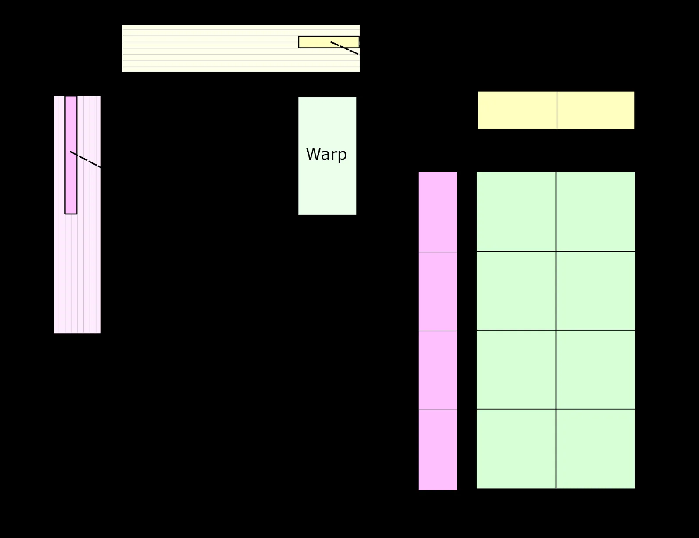

# From Naive GEMM to WMMA: Where Each CUDA Kernel Stalls

*2026-05-31 · updated 2026-07-21 · CUDA / GPU kernels*

<figure class="pb-article-hero pb-article-contain">
  
  <figcaption>WMMA warp-level tile structure<span class="pb-cap-inline"><span class="pb-cap-dot"> · </span><a href="https://developer.nvidia.com/blog/cutlass-linear-algebra-cuda/">Source: NVIDIA Developer</a></span></figcaption>
</figure>

This article follows one GEMM through three implementations: one output element per thread, shared-memory tiling, and warp-level WMMA. Each version is compared with cuBLAS on the same GPU. GEMM sits underneath the linear layers and attention projections in an LLM.

## 1. GEMM in a transformer forward pass

A transformer forward pass contains a stack of matrix multiplications. GEMM performance determines much of the cost of linear projections, while the kernel’s memory traffic, tile shape, and precision decide how closely it approaches the GPU’s compute throughput. The three versions below expose those constraints one at a time.

## 2. Naive GEMM: memory-bound by construction

The textbook kernel assigns one thread per output element `C[i][j]` and loops over `k`:

```
C[i][j] = Σ_k A[i][k] * B[k][j]
```

It is correct and slow. Every thread re-reads entire rows of `A` and columns of `B` from global memory, so the same values are fetched from DRAM hundreds of times. The arithmetic units wait on loads because arithmetic intensity (FLOPs per byte) is too low to approach peak compute.

## 3. Tiled GEMM: reuse through shared memory

Shared-memory tiling changes the data path. Threads in a block cooperatively load a tile of `A` and `B` into on-chip shared memory, reuse those values for partial sums, and then advance along `k`:

1. Load a `TILE × TILE` block of `A` and `B` into shared memory with coalesced accesses.
2. Call `__syncthreads()`.
3. Accumulate each thread’s partial product from the shared tiles.
4. Synchronize again and load the next tile along `k`.

Tiling increases reuse before another global-memory load. Whether the kernel becomes compute-bound depends on tile size, occupancy, layout, and matrix shape; tiling alone does not guarantee that transition.

## 4. Tensor Cores through WMMA

Tiling can saturate CUDA cores. Tensor Cores are a separate execution unit for matrix-multiply-accumulate instructions, for example a 16×16×16 `D = A·B + C` operation per warp with half-precision inputs and FP32 accumulation. CUDA C++ exposes this path through the WMMA (Warp Matrix Multiply-Accumulate) API:

```cpp
using namespace nvcuda::wmma;
fragment<matrix_a, 16,16,16, half, row_major> a_frag;
fragment<matrix_b, 16,16,16, half, col_major> b_frag;
fragment<accumulator, 16,16,16, float>        c_frag;

fill_fragment(c_frag, 0.0f);
for (int k = 0; k < K; k += 16) {
    load_matrix_sync(a_frag, A + ..., lda);
    load_matrix_sync(b_frag, B + ..., ldb);
    mma_sync(c_frag, a_frag, b_frag, c_frag);   // Tensor Core MMA
}
store_matrix_sync(C + ..., c_frag, ldc, mem_row_major);
```

Supported fragment shapes, layouts, and precision combinations depend on the GPU architecture. The CUDA Programming Guide, rather than this shortened kernel, defines the exact requirements.[^cuda-guide]

WMMA assigns each fragment to a warp. The API exposes fragment load, MMA, and store operations rather than a stable per-thread element mapping. Inputs may use FP16 or BF16 (and FP8 or FP4 on newer architectures), while accumulation commonly uses FP32.

## 5. Compare against cuBLAS on the same shape

cuBLAS is the production baseline, not a universal upper bound for every shape. It uses register tiling, double buffering, swizzled layouts, and architecture-specific tuning. A specialized hand-written kernel can exceed a selected cuBLAS path on some shapes, so report both absolute throughput and the ratio to cuBLAS under matched conditions.

| Kernel| Typical regime|
| --- | --- |
| Naive | A few percent of peak; memory-bound|
| Tiled (shared memory)| Higher reuse; often still CUDA-core bound|
| WMMA (Tensor Core)| A meaningful fraction of the matched cuBLAS result|
| cuBLAS | Production baseline for the selected shape and algorithm (100%)|

A reproducible result needs the GPU, matrix shape, precision, warm-up, timing method, cuBLAS algorithm, and measured TFLOP/s. The cuBLAS ratio belongs beside those values; results reported for `sm_90` and `sm_120` must remain separate. Nsight Compute can then identify whether the remaining limit is memory throughput, Tensor Core utilization, or occupancy.

## 6. From WMMA to Blackwell `tcgen05`

Each GPU generation changes the precision and tile shapes accepted by the MMA unit. Hopper added FP8; Blackwell adds FP4 and a new Tensor Core instruction generation, `tcgen05`. The warp-level WMMA path remains useful background, but Blackwell kernels use different data movement and instruction interfaces.[^blackwell]

→ More field notes on the NVIDIA stack:
[wayne.is-a.dev](https://wayne.is-a.dev/)

[^cuda-guide]: [CUDA C++ Programming Guide: Warp Matrix Functions](https://docs.nvidia.com/cuda/cuda-c-programming-guide/index.html#warp-matrix-functions), NVIDIA’s specification for WMMA fragments, layouts, and synchronization requirements.
[^blackwell]: [NVIDIA Blackwell Architecture Technical Brief](https://resources.nvidia.com/en-us-blackwell-architecture), used for the generation-level Tensor Core and low-precision capability summary.
