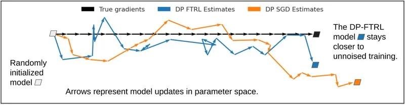

# FedAvg Under Non-IID Data: What DP-SGD and Secure Aggregation Protect

*2026-05-31 · updated 2026-07-21 · privacy-preserving ML*

<figure class="pb-article-hero">
  
  <figcaption>Federated learning with formal DP guarantees · <a href="https://research.google/blog/federated-learning-with-formal-differential-privacy-guarantees/">Source: Google Research</a></figcaption>
</figure>

The [**federated-learning-lab**](https://github.com/waynehacking8/federated-learning-lab)[^fl-repo] implements FedAvg, FedProx, SCAFFOLD, DP-SGD, and secure aggregation from scratch. Its tests and experiments show where Non-IID data causes client drift, where extra communication rounds matter more than a different optimizer, and which privacy threat each defense covers.

The repository includes 33/33 passing tests and cross-checks the implementations against the cited literature.

## 1. The FedAvg training loop

Raw training examples remain on each client, while model updates are sent to an aggregation server. The canonical FedAvg loop is:[^fedavg]

1. The server broadcasts the global model.
2. Each client runs a few local SGD epochs on its own data.
3. Each client returns its updated weights.
4. The server computes a data-size-weighted average to produce the next global model.

FedAvg keeps raw examples local, but heterogeneous client distributions make the local updates drift in different directions.

## 2. The Non-IID problem

FedAvg works best when participating clients sample similar distributions. Real clients differ: one hospital sees a different case mix from another, and one phone’s keyboard sees different language. Under Non-IID data, the average of those local updates can land in a region that is poor for many clients. This is client drift.

The lab implements and measures two common corrections:

- **FedProx** adds a proximal term that penalizes movement too far from the global model. It can stabilize training when clients are heterogeneous.[^fedprox]
- **SCAFFOLD** tracks control variates that estimate and subtract the drift direction. It communicates more state, but corrects bias that FedProx only damps.[^scaffold]

On the label-skewed MNIST split in this repository, FedProx and SCAFFOLD did not consistently outperform FedAvg by a large margin. Increasing communication rounds sometimes had more effect.

## 3. Differential privacy: local data can still leak

Keeping raw data on-device does not by itself provide privacy. Model updates can expose information through membership inference or gradient inversion. DP-SGD adds a formal differential-privacy bound to training.[^dpsgd]

DP-SGD changes each training step in two ways:

1. **Per-sample gradient clipping** bounds each example’s contribution to a maximum norm `C`.
2. **Gaussian noise** adds noise calibrated to `C` to the summed gradients.

An $(\varepsilon,\delta)$-DP bound limits how much the output distribution can change when one example is added or removed. Lower $\varepsilon$ generally requires more noise, so the report must show privacy budget and utility together.

## 4. Secure aggregation hides individual updates

DP limits what the final model can reveal. Secure aggregation addresses a different threat: an aggregation server inspecting each client’s update. Clients mask their updates so the server can recover only the sum; the individual masks cancel when aggregated.[^secagg]

The two mechanisms are complementary. DP bounds model leakage, while secure aggregation limits what the server observes during training.

## 5. Implementation checks

A clipping bug or miscalibrated noise multiplier can invalidate the intended privacy bound. The lab therefore checks four things:

- Implementations cover FedAvg, FedProx, SCAFFOLD, FedPer, Byzantine-robust aggregation, FedAdam, and FedLoRA.
- DP tests check clipping and noise behavior rather than only final accuracy.
- Literature cross-checks verify that measured behavior is consistent with the cited methods.
- The 33/33 tests and negative results remain in the repository with reproduction commands.

→ Implementations, tests, and negative results:
[github.com/waynehacking8/federated-learning-lab](https://github.com/waynehacking8/federated-learning-lab)

[^fl-repo]: [Federated Learning Lab](https://github.com/waynehacking8/federated-learning-lab), the primary artifact for implementations, tests, and measured negative results discussed here.
[^fedavg]: [McMahan et al., “Communication-Efficient Learning of Deep Networks from Decentralized Data”](https://proceedings.mlr.press/v54/mcmahan17a.html).
[^fedprox]: [Li et al., “Federated Optimization in Heterogeneous Networks”](https://proceedings.mlsys.org/paper_files/paper/2020/hash/1f5fe83998a09396ebe6477d9475ba0c-Abstract.html).
[^scaffold]: [Karimireddy et al., “SCAFFOLD: Stochastic Controlled Averaging for Federated Learning”](https://proceedings.mlr.press/v119/karimireddy20a.html).
[^dpsgd]: [Abadi et al., “Deep Learning with Differential Privacy”](https://dl.acm.org/doi/10.1145/2976749.2978318).
[^secagg]: [Bonawitz et al., “Practical Secure Aggregation for Privacy-Preserving Machine Learning”](https://research.google/pubs/practical-secure-aggregation-for-privacy-preserving-machine-learning/).
