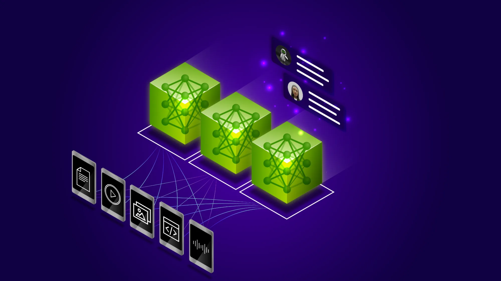

# TensorRT-LLM vs vLLM on 4×H100: The Concurrency Crossover

*2026-05-31 · updated 2026-07-21 · LLM serving / NVIDIA stack*

<figure class="pb-article-hero">
  
  <figcaption>TensorRT-LLM production serving · <a href="https://developer.nvidia.com/blog/scaling-llms-with-nvidia-triton-and-nvidia-tensorrt-llm-using-kubernetes/">Source: NVIDIA Developer</a></figcaption>
</figure>

The [**trtllm-triton-serving**](https://github.com/waynehacking8/trtllm-triton-serving) harness takes an open-weights Hugging Face checkpoint through a TensorRT-LLM engine build and exposes it with `trtllm-serve` or Triton. The matched-work benchmark compares that stack with vLLM on 4× H100 connected by NVLink.[^serving-repo]

## 1. The serving pipeline

The path from checkpoint to endpoint has four stages. A choice at any stage can change latency, throughput, or accuracy:

1. **Checkpoint**: a Hugging Face model.
2. **Engine build**: compile a TensorRT-LLM engine for a selected tensor-parallel degree, precision, and batching policy.
3. **Model repository**: wrap the engine in a Triton `tensorrt_llm` backend repository.
4. **Serving and load test**: expose an OpenAI-compatible endpoint and drive it with controlled concurrency.

TensorRT-LLM builds an engine for a selected GPU architecture, TP degree, precision, and batching configuration. vLLM makes more of those decisions at runtime, so the two stacks trade build-time specialization for runtime flexibility.[^trt-docs]

## 2. Tensor parallelism (TP)

When a model does not fit on one GPU, or when the target is lower latency, TensorRT-LLM can shard each layer across GPUs. On a 4× H100 NVLink host, `TP=4` introduces all-reduce communication across all four GPUs during each forward pass.

> On this fabric, all-reduce reaches about 77% of the NVLink budget (see the separate [NVLink-wall notes](nccl-nvlink-bandwidth.md)). Prefill uses large tensors and benefits from bandwidth. Decode communicates one token at a time and can hit the small-message latency floor; adding TP beyond that point can make decode slower.
>
Choose TP for the message sizes and latency regime of the deployed workload.

## 3. Precision: FP16 vs FP8

This benchmark compares FP16 and FP8 on Hopper:

| Precision | Memory| Throughput| Accuracy risk|
| --- | --- | --- | --- |
| **FP16** | baseline| baseline| reference|
| **FP8** | ~½ weights + KV cache| higher| small, model-dependent|

FP8 uses Hopper Transformer Engine and reduces weight and KV-cache storage. The accuracy delta must be measured on the target workload, under the same harness as the throughput result.

## 4. Continuous batching and paged KV cache

Two features shape the production configurations compared here:

- **In-flight (continuous) batching** lets new requests join a running batch at the next iteration instead of waiting for it to drain. Both vLLM and TensorRT-LLM support it.
- **Paged KV cache** allocates cache in pages rather than reserving the worst-case sequence length for each request, allowing more concurrent sequences to fit.

Results without these features describe static batching rather than the production configurations measured here.

## 5. Match the generated work

Completion length is a confounder: a stack that emits fewer tokens can appear faster while doing less work. The harness therefore forces every request to decode exactly 256 tokens with `ignore_eos=True` and matched minimum and maximum token limits.

Report all metrics at matched concurrency:

- **Throughput** in total tokens/s.
- **TTFT (time to first token)**, dominated by prefill.
- **Inter-token latency**, dominated by decode.

## 6. Triton as the deployment surface

The benchmark uses TensorRT-LLM’s OpenAI server, `trtllm-serve`. The repository also includes a Triton `tensorrt_llm` backend model repository for deployments that need Triton metrics, health checks, ensembles, or multi-model hosting.[^triton-docs]

The Triton path can place tokenizer, engine, and detokenizer stages in one ensemble and expose them through a shared control plane.

## 7. Measured crossover on 4×H100

On the matched-work sweep, TensorRT-LLM led at low-to-mid concurrency and vLLM led at high concurrency:

- **TensorRT-LLM with CUDA Graphs leads at low-to-mid concurrency.** Ahead-of-time specialization and graph capture reduce per-iteration launch overhead when batches are small, lowering TTFT and inter-token latency.
- **vLLM leads at high concurrency.** In the throughput-saturated regime, its scheduler keeps the GPU packed and the launch-overhead advantage no longer determines the result.

> One configuration bug changed this curve: CUDA Graphs only help when the graph setting is actually enabled. A misconfigured run made TensorRT-LLM look only slightly faster; fixing the setting moved the low-concurrency result substantially.
>
Choose from the measured load regime: TensorRT-LLM with CUDA Graphs for the latency-sensitive low/mid-concurrency range, and vLLM for the tested high-concurrency throughput range. Rerun the sweep on the target hardware before carrying over the crossover.

→ Full pipeline, Triton model repository, and matched-work harness:
[github.com/waynehacking8/trtllm-triton-serving](https://github.com/waynehacking8/trtllm-triton-serving)

[^serving-repo]: [TensorRT-LLM + Triton serving benchmark](https://github.com/waynehacking8/trtllm-triton-serving), the primary artifact for engine configs, the matched-work harness, and the measured crossover.
[^trt-docs]: [TensorRT-LLM documentation](https://nvidia.github.io/TensorRT-LLM/), NVIDIA’s engine-build and runtime reference.
[^triton-docs]: [Triton Inference Server documentation](https://docs.nvidia.com/deeplearning/triton-inference-server/user-guide/docs/), NVIDIA’s model-repository, scheduling, metrics, and protocol reference.
