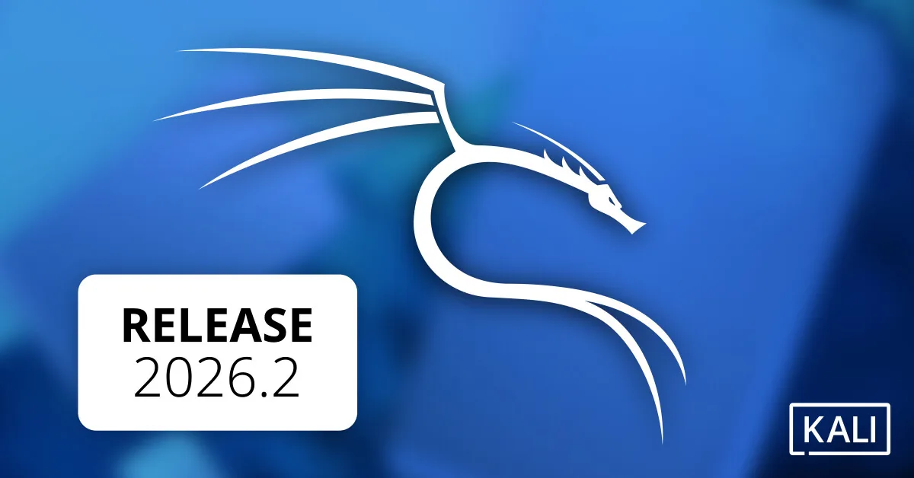

# A Pentest Is Not a Scanner: From Authorization Boundaries to Retestable Evidence

*2025-01-10 · updated 2026-07-21 · cybersecurity / methodology*

<figure class="pb-article-hero">
  
  <figcaption>Kali Linux security testing environment · <a href="https://www.kali.org/blog/kali-linux-2026-2-release/">Source: Kali Linux</a></figcaption>
</figure>

A vulnerability scanner tells you "this version may have a problem." A penetration test has to answer harder questions. Within an **explicitly authorized scope**, does the attack path really work, what business impact can it cause, and after the fix, can the same evidence confirm the risk is gone?

To decide whether a piece of work counts as a penetration test, check whether it has traceable hypotheses, minimal validation, and controls on the risk of the testing itself.

## Write the Rules of Engagement first

Without written authorization, there is no penetration test. Before starting, the Rules of Engagement (RoE) should cover at least the following:[^nist]

- The exact IPs, domains, APIs, accounts and environments in scope, and whether third-party SaaS is covered by a separate authorization.
- Allowed and forbidden techniques, such as social engineering, DoS, password spraying or data exfiltration.
- Testing windows, source IPs, rate limits, emergency stop conditions and a 24/7 contact.
- How sensitive data is handled: whether it may be read, how long it may be kept, and how it is encrypted and destroyed.
- The limit of what counts as proof of success. A harmless marker or a minimal data sample is usually enough, and there is no need to carry off the whole database.

The RoE also determines the test method. When production forbids destructive writes, prepare a read-only proof first. When a system cannot take a scan burst, write the rate limit into the test parameters so nobody has to guess on the spot.

## Black box, gray box and white box differ in how much is known

| Mode | What is known | Question it suits | Blind spot |
| --- | --- | --- | --- |
| Black box | Public entry points and very little background | How exposed is the external attack surface? | Much of the time goes to discovery, so deep coverage is low |
| Gray box | An ordinary user account, part of the architecture | Are privilege boundaries and authenticated flows safe? | May miss source-level defects |
| White box | Source code, architecture, test accounts and configuration | Can the critical paths be covered systematically? | Information conditions differ from a real external attacker |

In practice I prefer gray/white box to raise coverage, then keep a stretch of black-box validation to check the public surface. Hiding information does not automatically make a test more realistic. It only trades limited hours for enumeration.

## An auditable test flow

### 1. Scope and attack-surface inventory

First draw the assets, trust boundaries, identity roles, data flows and third-party dependencies. DNS, ports, routes, API schemas and cloud identities are inventory, and at this point nothing is being proven yet.

### 2. Write the threat hypothesis first

Each test item should be expressible as one falsifiable sentence, for example: "Can an object identifier from tenant A be read in a session of tenant B?" This makes it easier to see how far coverage reaches than "run a scanner once", and it maps directly onto the test categories of the OWASP Web Security Testing Guide.[^owasp-wstg]

### 3. Discovery and manual triage

Scanners, SAST, dependency audits and service enumeration are good for finding candidates, not for reporting findings directly. A version banner may be a backport, and a status code may be rewritten by a WAF. Every candidate result needs manual validation of its prerequisites, reachability and existing controls.

### 4. Minimal exploitation

Stop validating once the impact is proven. If reading one synthetic record proves an IDOR, do not enumerate in bulk. If a harmless command like `whoami` proves execution, there is no need to set up persistence. Any pivot beyond the RoE stops first so authorization can be obtained again.

### 5. Evidence chain and cleanup

A retestable finding should include the time, the test source, the prior identity, the full request/response, the affected asset, a minimal PoC, the observed impact and a cleanup record. Tokens, cookies, personal data and secrets are masked in the report, and the raw evidence is stored encrypted as agreed.

### 6. Fix retest

A retest cannot just check whether the page returns 403. First replay the original PoC, then test adjacent bypasses (different method, encoding, role, object type), and finally confirm the fix did not break legitimate flows. The conclusion is one of fixed, partially fixed, not fixed or cannot retest, which avoids a vague "handled".

## Risk scores must connect to business impact

CVSS gives a comparable technical severity, but priority still has to account for exposure, asset value, existing controls and exploit preconditions. Triage can be thought of as

$$
R = f(\text{technical impact},\text{likelihood},\text{exposure},
\text{asset value},\text{controls}).
\tag{1}
$$

So the same injection primitive should not get the same priority on an isolated test tool and on a public payment API. The report needs to keep both the CVSS vector and the organization-specific rationale, not just a red number.[^cvss]

## Pick tools by the testing question

- **Assets and network surface**: DNS/ASN inventory, Nmap-style service discovery.
- **Web/API**: intercepting proxy, schema-driven API tests, OWASP ZAP-style automation aids.
- **Code and supply chain**: SAST, secret scan, SBOM/dependency audit.
- **Cloud / identity**: IAM policy analysis, role assumption and storage exposure checks.
- **Evidence and reproduction**: version-controlled request fixtures, timestamps, hashes and retest scripts.

Kali provides the tools, while the test process is defined by PTES, NIST SP 800-115 and OWASP WSTG, including how to plan, execute, record and communicate the test.[^ptes][^nist][^owasp-wstg]

## A finding should let the fixer answer six things

1. Which asset and version are affected?
2. What identity and preconditions are needed?
3. What are the shortest reproduction steps?
4. What technical and business impact was actually observed?
5. Does the suggested fix address the root cause or is it a temporary compensating control?
6. What acceptance test shows the fix is complete?

At delivery, the team should be able to confirm the attack path that holds, the evidence needed to reproduce and fix it, and whether the whole test stayed within the authorization and operational boundaries.

[^nist]: [NIST SP 800-115, Technical Guide to Information Security Testing and Assessment](https://csrc.nist.gov/pubs/sp/800/115/final).
[^owasp-wstg]: [OWASP Web Security Testing Guide](https://owasp.org/www-project-web-security-testing-guide/).
[^ptes]: [Penetration Testing Execution Standard](http://www.pentest-standard.org/index.php/Main_Page).
[^cvss]: [FIRST Common Vulnerability Scoring System v4.0](https://www.first.org/cvss/v4.0/).
