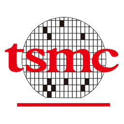

---
hide:
  - navigation
  - toc
---

# About

Hi, I'm **Wayne** 👋, a software engineer on LLM infrastructure at
<a href="https://ailabs.tw/">Taiwan AILabs</a>,
building and running on-prem LLM systems across Kubernetes, GPU runtime,
networking, storage, and model-serving endpoints.

Previously, I was the sole developer of an enterprise multi-agent AI platform at
<a href="https://syncrobotic.ai/">SYNCROBOTIC</a>, built internal coding agents at
<a href="https://www.advantech.com/en">Advantech</a>,
and served at <a href="https://www.tsmc.com/english">TSMC</a>
under the national R&D program. I hold an M.S. in Computer Science from
<a href="https://www.ntust.edu.tw/">NTUST</a>
(GPA 4.09), where I researched **LLM safety alignment** and **privacy-preserving ML**
in Prof. Shao-Jui Wang's lab.

Outside work I contribute upstream across the LLM-inference stack, with **20+
merged/landed changes** spanning
<a href="https://github.com/flashinfer-ai/flashinfer">FlashInfer</a>,
<a href="https://github.com/vllm-project/vllm">vLLM</a>,
<a href="https://github.com/sgl-project/sglang">SGLang</a>,
<a href="https://github.com/pytorch/pytorch">PyTorch</a>,
<a href="https://github.com/ai-dynamo/dynamo">Dynamo</a>,
<a href="https://github.com/NVIDIA">NVIDIA</a>
<a href="https://github.com/NVIDIA/cutlass">CUTLASS</a> / <a href="https://github.com/NVIDIA/TensorRT-LLM">TensorRT-LLM</a>, and
<a href="https://github.com/InternLM/lmdeploy">LMDeploy</a>,
including SM120/NVFP4 correctness fixes in FlashInfer and an NCCL broadcast fix
landed in PyTorch. See the auto-updating [PR wall](https://prs.wayne.is-a.dev)
for the complete record.

## Focus

Broadly, I care about **inference performance you can trust**: fast kernels that also
compute the right answer. Three threads:

1. **Serving internals**: KV-cache, quantization trade-offs, attention kernels,
   enough depth to reason about cost and latency *at design time*.
2. **Upstream enablement**: early consumer-Blackwell (**SM120**) and **NVFP4** support
   across kernels → engines → disaggregated serving; my favorite prey is the
   *silent-correctness* bug: tests green, answers wrong.
3. **Trustworthy ML**: safety alignment against harmful fine-tuning; federated
   learning, differential privacy, secure multi-party computation.

## News

<dl>
  <dt>Jul 2026</dt>
  <dd>💼 Joined <a href="https://ailabs.tw/"><strong>Taiwan AILabs</strong></a>, on-prem LLM deployments (FedGPT).</dd>
  <dt>Jul 2026</dt>
  <dd>🧱 The <a href="https://prs.wayne.is-a.dev">live PR wall</a> went up, every
      upstream patch, auto-updating.</dd>
  <dt>Apr 2026</dt>
  <dd>🎓 M.S. in Computer Science from <a href="https://www.ntust.edu.tw/"><strong>NTUST</strong></a>, GPA 4.09.</dd>
  <dt>Sep 2025</dt>
  <dd>💼 Joined <a href="https://syncrobotic.ai/"><strong>SYNCROBOTIC</strong></a>, sole developer of an enterprise
      multi-agent platform, shipped at two customers.</dd>
  <dt>Jun 2025</dt>
  <dd>💼 Summer at <a href="https://www.advantech.com/en"><strong>Advantech</strong></a> building internal coding agents.</dd>
  <dt>Dec 2024</dt>
  <dd>📜 <a href="https://learn.nvidia.com/">NVIDIA DLI</a> certificates: Accelerated Computing with CUDA (Python &amp; C/C++).</dd>
  <dt>Aug 2024</dt>
  <dd>🔬 Started graduate research on LLM security &amp; privacy-preserving ML at
      <a href="https://www.ntust.edu.tw/">NTUST</a>.</dd>
</dl>

## Misc

I'm from Taiwan :flag_tw: and based in Taipei. Away from a profiler you'll find me tending an
over-engineered Obsidian vault. The views on this site are my own and do not represent
those of my employer or affiliated institutions.
