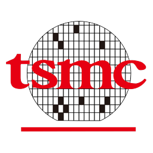

---
hide:
  - navigation
  - toc
---

# About

Hi, I'm **Wayne**, a field application engineer on LLM infrastructure at
<a href="https://ailabs.tw/">Taiwan AILabs</a>,
where I deploy and run on-prem LLM systems: Kubernetes, the GPU runtime,
networking, storage, and the model-serving endpoints on top.

Before that I was the only developer on an enterprise multi-agent AI platform at
<a href="https://syncrobotic.ai/">SYNCROBOTIC</a>, built internal coding agents at
<a href="https://www.advantech.com/en">Advantech</a>,
and did my R&D alternative military service at <a href="https://www.tsmc.com/english">TSMC</a>.
I have an M.S. in Computer Science from
<a href="https://www.ntust.edu.tw/">NTUST</a>
(GPA 4.09), where I worked on LLM safety alignment and privacy-preserving ML
in Prof. Shao-Jui Wang's lab.

In my own time I send patches upstream to the LLM inference stack. More than 20
have merged so far, in
<a href="https://github.com/flashinfer-ai/flashinfer">FlashInfer</a>,
<a href="https://github.com/vllm-project/vllm">vLLM</a>,
<a href="https://github.com/sgl-project/sglang">SGLang</a>,
<a href="https://github.com/pytorch/pytorch">PyTorch</a>,
<a href="https://github.com/ai-dynamo/dynamo">Dynamo</a>,
<a href="https://github.com/NVIDIA">NVIDIA</a>
<a href="https://github.com/NVIDIA/cutlass">CUTLASS</a> / <a href="https://github.com/NVIDIA/TensorRT-LLM">TensorRT-LLM</a>, and
<a href="https://github.com/InternLM/lmdeploy">LMDeploy</a>,
among them SM120 and NVFP4 correctness fixes in FlashInfer and an NCCL broadcast
fix in PyTorch. The [PR wall](https://prs.wayne.is-a.dev) lists every one and
updates itself from GitHub.

## Focus

I want inference that is fast and also gives the right answer. In practice that
covers three areas:

1. **Serving internals**: KV cache, quantization trade-offs and attention kernels,
   known well enough to estimate cost and latency before anything gets built.
2. **Upstream enablement**: getting early consumer Blackwell (SM120) and NVFP4 to
   work in kernels, engines and disaggregated serving. The bugs I like most are
   the silent ones, where every test passes and the output is still wrong.
3. **Trustworthy ML**: safety alignment against harmful fine-tuning, federated
   learning, differential privacy, and secure multi-party computation.

## News

<dl>
  <dt>Jul 2026</dt>
  <dd>Joined <a href="https://ailabs.tw/"><strong>Taiwan AILabs</strong></a>, on-prem LLM deployments (FedGPT).</dd>
  <dt>Jul 2026</dt>
  <dd>Put up the <a href="https://prs.wayne.is-a.dev">PR wall</a>, a page that
      lists every upstream patch and updates itself.</dd>
  <dt>Apr 2026</dt>
  <dd>M.S. in Computer Science from <a href="https://www.ntust.edu.tw/"><strong>NTUST</strong></a>, GPA 4.09.</dd>
  <dt>Sep 2025</dt>
  <dd>Joined <a href="https://syncrobotic.ai/"><strong>SYNCROBOTIC</strong></a> as the only developer of an
      enterprise multi-agent platform, shipped to two customers.</dd>
  <dt>Jun 2025</dt>
  <dd>Summer at <a href="https://www.advantech.com/en"><strong>Advantech</strong></a> building internal coding agents.</dd>
  <dt>Dec 2024</dt>
  <dd><a href="https://learn.nvidia.com/">NVIDIA DLI</a> certificates: Accelerated Computing with CUDA (Python &amp; C/C++).</dd>
  <dt>Aug 2024</dt>
  <dd>Started graduate research on LLM security &amp; privacy-preserving ML at
      <a href="https://www.ntust.edu.tw/">NTUST</a>.</dd>
</dl>

## Misc

I'm from Taiwan and live in Taipei. Outside work I spend more time than I should on
my Obsidian vault. The views on this site are my own and do not represent those of
my employer or affiliated institutions.
